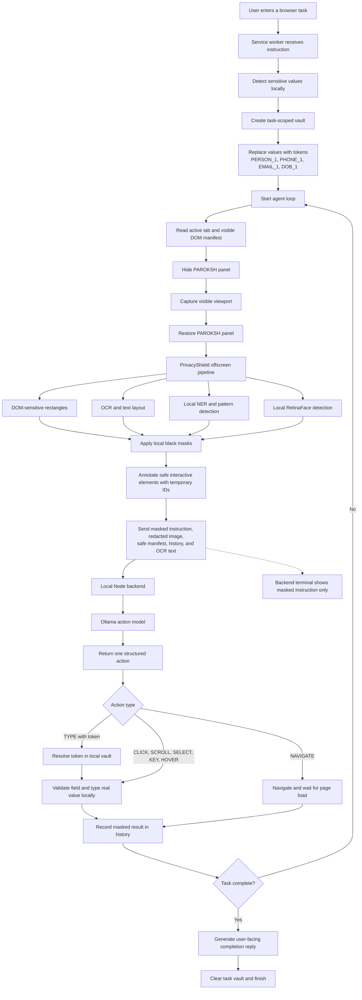

# PAROKSH

Privacy-first Chrome browser automation with local PII redaction.

PAROKSH is a Chrome Manifest V3 extension that accepts a natural-language browser task, captures the active viewport, removes sensitive information locally, asks a local Ollama/Gemma model for one structured action, executes that action in the page, and repeats until the task completes or fails.

> **Browser:** PAROKSH is designed for Google Chrome with Manifest V3.

## What it does

- Click, type, scroll, navigate, hover, select, and send keyboard actions.
- Uses DOM element IDs for normal page controls.
- Uses Chrome DevTools Protocol trusted input when canvas-based sites such as Google Docs require it.
- Redacts sensitive information before the screenshot is sent to the backend:
  - DOM-sensitive fields and visible DOM text patterns
  - OCR text and layout
  - local NER predictions
  - PAN, Aadhaar, phone, email, card, address, DOB, and related patterns
  - faces using a local RetinaFace-style ONNX model
- Keeps screenshots as plain black masks without `[PAN]`, `[FACE]`, or other labels.
- Provides a session dashboard with sanitized screenshots, task history, redaction totals, and measured runtime estimates.

## Architecture

```text
Chrome page
  ├─ content.js
  │    └─ floating panel and panel bridge
  └─ action-executor.js
       └─ visible DOM manifest, sensitive rectangles, and page actions

background.js (Manifest V3 service worker)
  ├─ captures the viewport with the panel temporarily hidden
  ├─ requests local PrivacyShield redaction
  ├─ annotates safe interactive elements with temporary IDs
  ├─ sends the redacted image and sanitized context to localhost:3000
  └─ executes the returned action and repeats the loop

PrivacyShield offscreen document
  ├─ Tesseract.js OCR
  ├─ BERT token-classification NER model
  ├─ regex and labeled-field detectors
  ├─ DOM-sensitive rectangles
  ├─ RetinaFace ONNX face detection
  └─ solid black canvas redaction

Local Node backend
  └─ Ollama /api/chat
       ├─ Gemma action model: structured JSON action
       └─ chat model: user-facing completion message
```

### End-to-end flowchart



### Processing sequence

1. The service worker reads the active tab and asks the content script for visible interactive elements.
2. The panel is set to `visibility:hidden` while `chrome.tabs.captureVisibleTab` captures the viewport.
3. The screenshot is processed inside the extension offscreen document.
4. DOM rectangles, OCR/NER boxes, pattern matches, and face boxes are blacked out locally.
5. The result is resized to a maximum dimension of 1600 pixels and converted to JPEG at quality `0.95` for the action request.
6. The background worker sends the redacted image, sanitized manifest, sanitized history, sanitized instruction, and safe OCR text to the backend.
7. The backend calls Ollama and returns one action.
8. Sensitive instruction values use task-scoped placeholders such as `[PHONE_1]`; the extension resolves them locally immediately before a `TYPE` action.
9. The extension executes the action, records the result, waits briefly, and starts the next step.
10. The loop stops on `DONE`, `ERROR`, cancellation, or the 30-step limit.

The extension applies local redaction before transmission, creating a clear application-level privacy boundary between page content and model context.

## Privacy and redaction

### DOM-first detection

The content script inspects visible filled controls locally. Field context can come from `aria-label`, `name`, `id`, `placeholder`, `autocomplete`, `type`, associated labels, and nearby label text. Sensitive fields include address, city, state, district, village, country, PIN/postal code, DOB, religion, name, phone, email, Aadhaar, PAN, password, and card fields.

It also scans visible DOM text nodes for common email, phone, PAN, Aadhaar-like, and card-number patterns and returns screen rectangles to PrivacyShield.

DOM context is used locally for detection. The model manifest contains structural metadata such as element ID, tag, role, type, autocomplete, coordinates, and dimensions, plus safe category labels for known sensitive controls.

### Sensitive instruction placeholders

Sensitive values explicitly included in a task instruction are stored in a memory-only task vault inside the extension. The backend and action model receive stable placeholders such as `[PERSON_1]`, `[PHONE_1]`, `[EMAIL_1]`, `[DOB_1]`, or `[ADDRESS_1]`. Each interactive field is classified locally, and a placeholder can only resolve into a matching category; for example, `[PERSON_1]` cannot be inserted into an Aadhaar field. Immediately before typing, the extension resolves the placeholder locally and inserts the real value into the matching page field. The task history, audit record, and backend terminal display the masked instruction and never the resolved value. The vault is discarded when the task ends.

### OCR, NER, and face detection

The offscreen pipeline uses:

- Tesseract.js with bundled English and Hindi OCR data.
- `model.onnx`, a local BERT token-classification model.
- Regex and labeled-field rules in `entities.js` and `sensitive.js`.
- `retinaface_r50.onnx`, a bundled local RetinaFace-style detector.

Block-level entities are blacked out while review-level entities such as some organizations and locations remain visible to preserve task context. Faces are blacked out using expanded, clamped detection rectangles. All output masks are plain black.

### Retention

- The backend writes every received image to `backend/temp/` for local session evidence.
- The offscreen PrivacyShield vault keeps up to 50 processed screenshots in memory for the session dashboard/export flow.
- Task audit records are kept in `chrome.storage.session`.
- Remove files from `backend/temp/` when the evidence is no longer needed.

## Models and runtime assets

- Action and chat model: `gemma4:31b-cloud`, configured in `backend/ollama/ollama.js` and `ollama2.js`.
- Ollama endpoint: `http://localhost:11434/api/chat`.
- Local NER model: `frontend/privacy-shield/model.onnx`.
- Local face model: `frontend/privacy-shield/retinaface_r50.onnx` (approximately 109 MB).
- RetinaFace license/attribution: `frontend/privacy-shield/retinaface_r50.LICENSE.txt`.
- ONNX Runtime Web, Tesseract.js, Tesseract core WASM, and OCR data are vendored under `frontend/privacy-shield/vendor/` and `tessdata/`.

The model files provide local OCR, entity recognition, and face detection. Detection results are surfaced through the session metrics and evaluation tools.

## Installation

### Prerequisites

- Windows/PowerShell or an equivalent environment.
- Node.js `>=18` for the backend.
- Google Chrome with Developer mode enabled.
- Ollama installed and running.
- The configured `gemma4:31b-cloud` model available to Ollama.

### Install backend dependencies

```powershell
cd C:\paroksh\backend
npm install
```

### Install popup build dependencies

```powershell
cd C:\paroksh\frontend\popup-src
npm install
```

Backend and popup dependencies are installed separately from their respective directories.

## Run

### Start the backend

```powershell
cd C:\paroksh\backend
npm start
```

The backend listens on port `3000` by default. Development mode is available with:

```powershell
npm run dev
```

### Start Ollama

```powershell
ollama run gemma4:31b-cloud
```

Ollama must remain available at `http://localhost:11434`.

### Build the popup

```powershell
cd C:\paroksh\frontend\popup-src
npm run build
```

Vite writes built assets into `frontend/frontend/`.

### Load the extension

1. Open `chrome://extensions/`.
2. Enable **Developer mode**.
3. Choose **Load unpacked**.
4. Select `C:\paroksh\frontend`.
5. Reload the extension after source or popup-build changes.
6. Refresh the target webpage.

## Backend API

The backend is implemented in `backend/server.js`.

### `GET /api/health`

Returns a diagnostic response containing backend status, configured model names, and the Ollama host.

### `POST /api/action`

Required fields:

```json
{
  "instruction": "Click Submit",
  "imageBase64": "data:image/jpeg;base64,...",
  "history": [],
  "elements": [],
  "safeText": "",
  "metrics": {}
}
```

Returns:

```json
{
  "action": {
    "action": "CLICK",
    "element_id": 12
  }
}
```

The route stores the received bytes in `backend/temp/` before forwarding the request to Ollama. The storage name identifies the local evidence file used by the session dashboard.

### `POST /api/reply`

Accepts `instruction`, `rawLog`, and `success`, then returns:

```json
{
  "reply": "..."
}
```

### Backend configuration

The repository uses these environment variables:

- `PORT` — backend port; defaults to `3000`.
- `ALLOWED_ORIGIN` — CORS response origin; defaults to `*`.

The backend accepts JSON request bodies up to 100 MB.

## Supported actions

The action model and background worker support:

```text
CLICK
TYPE
SCROLL
SELECT
NAVIGATE
HOVER
KEY
DONE
ERROR
```

The action prompt contains site/workflow guidance for search, Gmail, Google Docs/Sheets/Forms, generic forms, dropdowns, media sites, cookie banners, pagination, new tabs, destructive actions, CAPTCHA/login walls, loading states, ambiguity, and sensitive fields.

## Permissions and security considerations

The extension declares:

- `activeTab`
- `storage`
- `debugger`
- `offscreen`
- `downloads`

It requests host access to:

- `http://localhost:3000/*`
- `<all_urls>`

Content scripts run at `document_idle` on `<all_urls>`. The debugger permission is used for trusted coordinate input when normal DOM actions are insufficient.

Security configuration:

- The local HTTP API is intended for the local development environment.
- Configure `ALLOWED_ORIGIN` to define the permitted frontend origin.
- Keep the extension, Ollama, and Node backend within a trusted local Chrome profile and development environment.
- The `debugger` permission enables trusted coordinate input for advanced web applications.

## Session dashboard

Click the chart icon in the floating PAROKSH panel to open `frontend/audit.html`.

The dashboard displays:

- Task count and completed task count.
- Sanitized screenshots from the in-memory PrivacyShield vault.
- Aggregate redaction totals.
- Task timestamps and status.
- Session estimates calculated from collected measurements.
- OCR, NER, face, paint, model-load, upload, execute, and memory timing data where available.

The dashboard presents measurements collected during the current session. Labeled benchmark data can be supplied to the evaluation harness for visual accuracy, PII precision/recall, and redaction-quality reporting.

### Performance matrix

The following is the current evidence-based matrix. `Not available` means the
existing screenshots and backend logs do not contain the labels or measurements
needed to calculate that value.

#### PAROKSH | PERFORMANCE MATRIX

| Section | Metric | Result | Evidence / calculation status |
|---|---|---:|---|
| Visual context | Accuracy | Not available | No expected action/target labels were stored for the screenshots. |
| PII detection | Precision | Not available | Requires labeled expected entities and detected entities. |
| PII detection | Recall | Not available | Requires labeled expected entities and detected entities. |
| Redaction | Precision | Not available | Requires original screenshots and expected redaction regions. |
| Client resources | RAM | Session-specific only | JavaScript heap snapshots exist in some logs; no complete session average was persisted. |
| Client resources | CPU | Not available | Requires OS-level profiling. |
| Client resources | Model assets | 331.3 MB | NER model: 227.2 MB; RetinaFace model: 104.1 MB. |
| Client resources | Startup | Not available | No complete PrivacyShield startup measurement was persisted. |
| End-to-end latency | Total | Not available | Complete task start/end measurements were not preserved in the available logs. |
| End-to-end latency | PrivacyShield | Not available | No complete aggregate of OCR, NER, face detection, and painting time was preserved. |
| End-to-end latency | AI reasoning | Partial | Individual model timings are present, but no complete session average was preserved. |
| End-to-end latency | Execution | Not available | Complete action-execution timing was not preserved in the available logs. |
| Test set | Stored redacted screenshots | 277 | Files present in `backend/temp/`. |
| Test set | Stored screenshot data | 32.6 MB | Combined size of the 277 redacted PNG files. |
| Test set | Webpages | Not available | The screenshot inventory does not identify unique webpages. |
| Test set | Tasks | Not available | Task boundaries cannot be reconstructed reliably from the screenshot folder. |
| Test set | Sensitive entities | Not available | Redacted screenshots do not preserve reliable ground-truth entity labels. |

This table must not be interpreted as a completed accuracy benchmark. Visual
context accuracy, PII precision/recall, redaction precision, CPU usage, startup
time, and complete latency averages should be filled only after running a
labeled test set and system profiling. The evaluation harness calculates PII
metrics from labeled cases rather than inferring them from black masks.

#### PII detection calculation

For every labeled screenshot, compare the expected PII entities with the entities detected by PAROKSH:

```text
True positive (TP):     expected PII detected correctly
False negative (FN):    expected PII missed
False positive (FP):    non-PII detected as PII

Precision = TP / (TP + FP)
Recall    = TP / (TP + FN)
F1        = 2 × Precision × Recall / (Precision + Recall)
```

Example:

```text
Expected entities: Name, DOB, Phone, Email, Address
Detected entities: Name, DOB, Phone, Email, Occupation

TP = 4
FN = 1
FP = 1

Precision = 4 / (4 + 1) = 80%
Recall    = 4 / (4 + 1) = 80%
F1        = 80%
```

The example numbers are illustrative only and must not be presented as PAROKSH benchmark results. Actual values should be calculated by running the evaluator against labeled screenshots:

```powershell
node C:\paroksh\frontend\privacy-shield\evaluation\evaluate.mjs labels.json
```

## Evaluation

The evaluator is:

```text
frontend/privacy-shield/evaluation/evaluate.mjs
```

Run it with a manually prepared labeled JSON file:

```powershell
node C:\paroksh\frontend\privacy-shield\evaluation\evaluate.mjs labels.json
```

The expected format is documented in:

```text
frontend/privacy-shield/evaluation/README.md
```

The evaluator reports entity-level precision, recall, F1, true positives, false positives, and false negatives. It accepts labeled screenshots and expected action targets for benchmark reporting.

For a meaningful demo benchmark, prepare a 20–50 screenshot set with:

- Expected PII entity types.
- Expected PII boxes where localization matters.
- Expected action and target element for visual-context evaluation.
- Non-sensitive text to measure false positives.

## Testing and validation

Available validation checks are:

```powershell
node --check C:\paroksh\frontend\extension-core\background.js
node --check C:\paroksh\frontend\extension-core\action-executor.js
node --check C:\paroksh\frontend\privacy-shield\pipeline.js
node --check C:\paroksh\frontend\privacy-shield\offscreen.js
node --check C:\paroksh\backend\server.js
node --check C:\paroksh\backend\ollama\ollama.js

cd C:\paroksh\frontend\popup-src
npm run build
```

Validate manually in Chrome with the backend and Ollama running. Exercise ordinary pages, forms, scroll containers, shadow DOM, images/PDFs, canvas applications, sensitive fields, faces, and pages that use trusted input.

## Directory map

```text
C:\paroksh
├── backend
│   ├── server.js
│   ├── package.json
│   ├── package-lock.json
│   ├── ollama
│   │   ├── ollama.js
│   │   └── ollama2.js
│   └── temp
└── frontend
    ├── manifest.json
    ├── audit.html
    ├── audit.css
    ├── audit.js
    ├── extension-core
    │   ├── background.js
    │   ├── content.js
    │   └── action-executor.js
    ├── popup-src
    │   ├── src
    │   ├── package.json
    │   └── vite.config.js
    ├── privacy-shield
    │   ├── model.onnx
    │   ├── retinaface_r50.onnx
    │   ├── pipeline.js
    │   ├── offscreen.js
    │   ├── lib
    │   ├── vendor
    │   └── tessdata
    └── frontend
        └── built popup assets
```

## Operating profile

- Chrome Manifest V3 with an unpacked-extension development workflow.
- Visible-viewport capture and step-by-step action execution.
- DOM, OCR, NER, regex, and RetinaFace analysis for page content.
- Temporary element IDs refreshed for each page manifest.
- Structured action validation and workflow guidance for common web applications.
- Local inference for OCR, entity recognition, and face detection.
- Optional JavaScript heap measurements through `performance.memory`.
- Face detection and redaction without identity recognition or biometric matching.

## Contributing

1. Make changes in the relevant backend, extension-core, PrivacyShield, or popup source directory.
2. Keep raw sensitive values out of logs, fixtures, screenshots, and commits.
3. Run JavaScript syntax checks and the popup build.
4. Test the changed flow manually in Chrome with the backend and Ollama running.
5. Update this README when routes, models, permissions, storage, or privacy behavior changes.
# paroksh-privacy-shield-SIH26171

